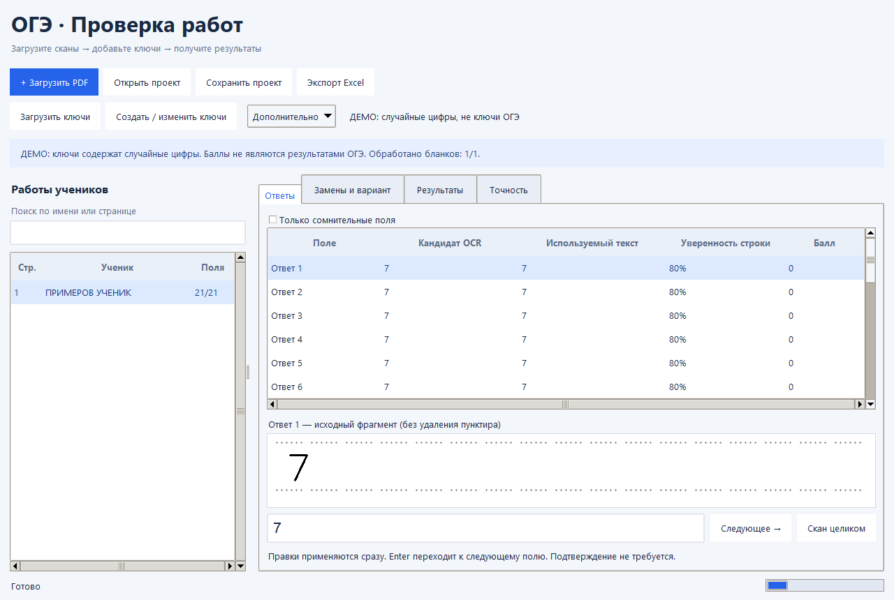

# ОГЭ · Проверка работ

**Локальное приложение для распознавания бланков и автоматической проверки кратких ответов.**

Загрузите PDF, добавьте ключи ответов и получите таблицу результатов.
Приложение работает на компьютере учителя и сохраняет проекты для последующего редактирования.



## Возможности

- Распознавание ФИО, класса, ответов 1–19 и блока замен.
- Восстановление бледных опорных меток и выравнивание обрезанных бланков.
- Автоматическая сверка с ключами без подтверждения каждого задания.
- Создание ключей вручную, импорт XLSX/CSV и поддержка альтернативных ответов.
- Просмотр фрагмента скана, ручные исправления и пересчёт баллов.
- Поиск ученика, сохранение JSON-проектов и экспорт результатов в Excel.
- Измерение качества OCR по отдельной эталонной расшифровке.
- Установщик Windows со встроенными моделями.

## Быстрый старт

Для готовой локальной сборки запустите `dist/installer/OGEChecker-Setup.exe`.
Установщик не хранится в исходниках Git; его можно прикрепить к GitHub Release.

Запуск из исходников на Windows, Python 3.10+ с Tcl/Tk:

```powershell
py -3 -m venv .venv
.venv/Scripts/python.exe -m pip install -e ".[desktop]"
run_windows.bat
```

На Linux создайте окружение через `python3`, установите зависимости командой
`.venv/bin/python -m pip install -e ".[desktop]"` и запустите `./run_linux.sh`.
При необходимости установите системный пакет Tcl/Tk.

## Как проверить работы

1. Нажмите **«Загрузить PDF»** или откройте сохранённый проект.
2. Загрузите ключи либо создайте их в редакторе.
3. Назначьте вариант одной работе или всему набору.
4. Просмотрите отмеченные сомнительные поля и при необходимости исправьте текст.
5. Сохраните проект и экспортируйте результаты в Excel.

Шаблоны ключей — в [examples](examples). Колонки: `Вариант`, `Задание`,
`Ответ`, `Баллы`. Допустимые альтернативы разделяются `|`.
Каждый вариант текущей версии содержит задания 1–19.

## Структура

```text
src/oge_checker/      приложение, ресурсы и модели OCR
scripts/training/    подготовка, обучение и оценка моделей
scripts/             экспорт публичных исходников и точка входа сборки
tests/               алгоритмические и GUI-тесты
packaging/           сборка Windows и проверка установщика
examples/            шаблоны ключей
docs/                разработка, измерения качества и снимок интерфейса
data/                локальные датасеты, исключённые из Git
.github/workflows/   автоматический запуск тестов
```

## Качество и ограничения

На контрольной выборке математических ответов получено **357/379 совпадений
(94,20%)**. На четырёх страницах нового набора — **64/76 (84,21%)**,
среди непустых ответов — **37/48 (77,08%)**. Методики сравнения различаются;
подробности и ограничения приведены в [отчёте о точности](docs/accuracy.md).

Приложение использует фиксированную геометрию поддерживаемого бланка.
Произвольные форматы, все предметы ОГЭ и развёрнутые решения не поддерживаются.
Ошибки почерка остаются: уверенность OCR не является гарантией правильности
текста или выставленных баллов. Снимок интерфейса выше использует вымышленные данные.

## Для разработчиков

```powershell
.venv/Scripts/python.exe -m unittest discover -s tests -q
.venv/Scripts/python.exe scripts/export_repository.py
```

[Установка, обучение, сборка и публикация](docs/development.md) ·
[Структура датасетов](data/README.md) ·
[Карточка моделей](src/oge_checker/models/README.md) ·
[Сторонние компоненты](THIRD_PARTY.md)

Датасеты сохранены локально. Для публикации без старой истории со сканами
используйте архив `dist/source/oge-checker-0.6.0-source.zip`, создаваемый
сценарием экспорта. Он не включает сканы, результаты учеников, окружение и `.git`.
